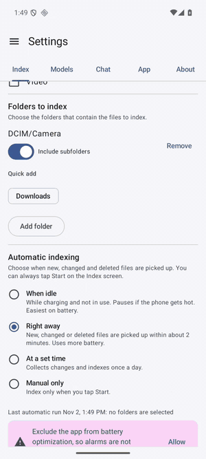
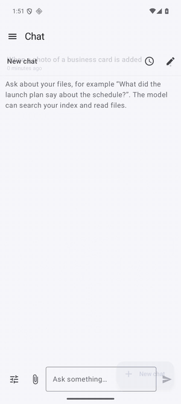

# 눈소리 (Nunsori)

[English](README.md)

*Local Search Anything.* **N**ative **U**nified **N**atural-language **S**earch, **O**ffline **R**ecall & **I**ndex. 눈(보고)과 소리(듣는) 이 두 가지로 파일을 이해한다는 뜻의 이름입니다.

폰에 있는 파일을 온디바이스 멀티모달 임베딩 모델로 인덱싱하고, 의미와 키워드로 검색하는 Android 앱입니다. 데이터는 기기 밖으로 나가지 않으며, 모델은 앱에 포함되지 않고 사용자가 직접 내려받습니다.

<p>


</p>

*왼쪽: 폰 안에서 파일을 인덱싱하고 의미로 검색합니다. 오른쪽: 채팅의 예약 작업이 새 명함 사진을 연락처로 만들어 줍니다(저장은 연락처 앱에서 직접 확인).*

## 기능

| 종류 | 인덱싱 대상 | 검색 방법 |
|---|---|---|
| 이미지 | 이미지 임베딩 + OCR 텍스트(ML Kit, 한국어·라틴) | 설명, 이미지 속 글자 |
| 텍스트 파일 | txt, md, html, xml, csv/tsv, srt/vtt를 겹치는 청크로 | 의미, 키워드 |
| 문서 | PDF 쪽(텍스트, OCR 폴백, 쪽 이미지), docx/pptx/xlsx·ODF는 텍스트 + 텍스트 카드 이미지 | 의미, 키워드, 쪽 |
| 음성 | 음성 전사(SenseVoice), 오디오 클립 임베딩(740M 모델) | 말한 내용, 소리, 시간 |
| 영상 | 장면 클립(클립당 최대 8프레임) + 음성 전사 | 화면 내용, 말, 시간 |

그 외: 내 파일로 답하는 온디바이스 Gemma 4 채팅(색인을 검색하고 파일을 읽는 도구, 고정 가능한 채팅별 기록, 나중에(또는 맞는 파일이 인덱싱될 때) 실행되어 채팅에 결과를 올리는 예약 작업, 승인하면 캘린더·연락처 앱이 내용이 채워진 채 열리거나 파일을 이동·휴지통으로 보내는 카드, 복사·공유와 파일 썸네일이 있는 마크다운 답변, 내 지침, 검색 결과에서 "채팅으로 묻기"), 실패한 파일 목록과 재시도, 저전력 인덱싱, 선택형 리소스 표시(GPU/CPU, 메모리), 하이브리드 랭킹(의미 + 정확한 단어 + "두바이" 같은 사진 촬영 장소), 파일 종류·날짜 필터, 결과 공유·다른 앱에서 열기, 자동 인덱싱(수동·즉시·예약·유휴), 모델 메모리 제어, 영어/한국어 UI, 다크 모드.

## 동작 방식

파일은 *세그먼트*(청크, 쪽, 클립)로 나뉘어 int8 임베딩과 함께 Room에 저장됩니다. 질의를 임베딩해 신호 그룹(시각·텍스트·음성)별로 모든 세그먼트와 비교하고, SQL 키워드 결과와 합쳐 파일 단위로 묶어 가장 잘 맞은 쪽/시간을 보여 줍니다. [아키텍처](docs/architecture.md) 참고.

## 요구 사항

Android 10 이상(minSdk 29). 모델: EmbeddingGemma 2 440M(388MB) 또는 740M(오디오 포함), 채팅 모델(Gemma 4 E2B 2.6GB, E4B 3.7GB 또는 Qwen2.5 1.5B 1.6GB), 음성 인식용 SenseVoice(163MB). 텍스트·문서는 "모든 파일 접근"이 필요합니다.

## 빠른 시작

```bash
source scripts/env.sh && scripts/fetch-sherpa-onnx.sh
./gradlew assembleDebug && scripts/emu-start.sh && scripts/run.sh
```

앱에서: 첫 실행 마법사가 인덱싱할 대상(종류·폴더), 내려받을 모델, 자동 인덱싱 방식을 차례로 묻습니다. 이후 인덱싱 시작, 검색. 자세한 내용은 [getting-started](docs/getting-started.md)(영어).

## 프라이버시

모든 처리는 기기에서 이뤄집니다. 네트워크는 Hugging Face와 GitHub에서 모델을 내려받을 때만 쓰입니다. [privacy](docs/privacy.md) 참고.

## 한계

Office 문서는 렌더링하지 않고(텍스트와 생성한 카드만 사용) 구형 .doc/.ppt/.xls, hwp는 지원하지 않습니다. 메모리 전체 탐색은 약 30만 세그먼트가 목표이며 짧은 영상 구간은 놓칠 수 있습니다. [roadmap](docs/roadmap.md) 참고.

## 문서

[docs/](docs/README.md) · [기여하기](CONTRIBUTING.md) · [서드파티 고지](THIRD_PARTY_NOTICES.md)

## 라이선스

[Apache-2.0](LICENSE). Copyright 2026 Taehun Kim. 내려받는 모델은 각자의 라이선스를 따릅니다.
