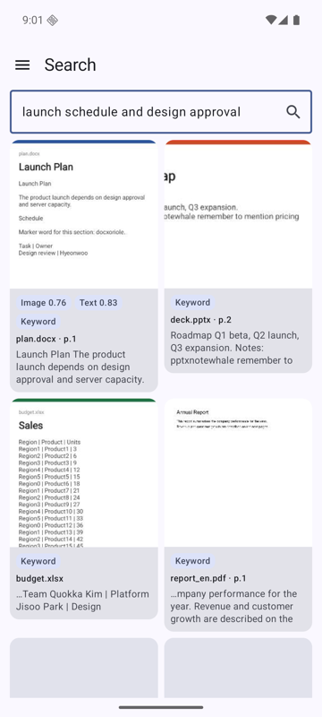
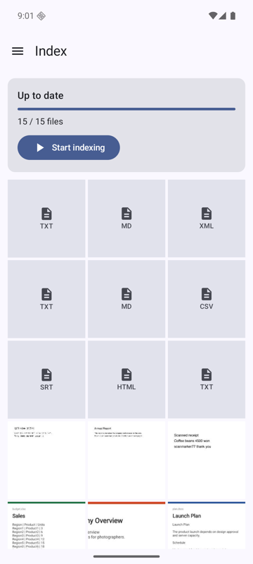
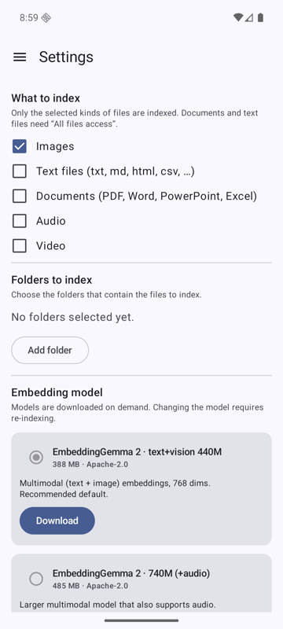
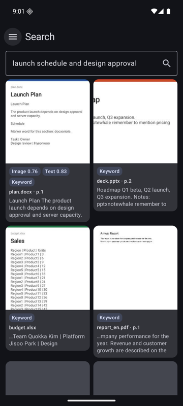

# Local Search Anything

[한국어](README.ko.md)

An Android app that indexes the files on your phone with on-device multimodal embedding models and lets you search them by meaning and by keyword. Nothing leaves the device; models are downloaded by you, never bundled.

<p>




</p>

## Features

| Kind | What is indexed | Searchable by |
|---|---|---|
| Images | Image embedding + OCR text (ML Kit, Korean and Latin) | Description, text in the image |
| Text files | txt, md, html, xml, csv/tsv, srt/vtt in overlapping chunks | Meaning, keywords |
| Documents | PDF pages (text, OCR fallback, page image); docx/pptx/xlsx and ODF as text + text card image | Meaning, keywords, page |
| Audio | Speech transcript (SenseVoice); audio clip embeddings (740M model) | Spoken words, sound, time |
| Video | Scene clips (up to 8 frames each) + speech transcript | Visual content, speech, time |

Also: hybrid ranking (semantic + exact keywords), share/open results, automatic indexing (manual, immediate, scheduled, idle), model memory control, English and Korean UI, dark mode.

## How it works

Files become *segments* (a chunk, a page, a clip) with an int8 embedding, stored in Room. A query is embedded, compared with all segments per signal group (visual, text, audio), combined with SQL keyword matches, and grouped per file with the best page or time. See [architecture](docs/architecture.md).

## Requirements

Android 10+ (minSdk 29). Models: EmbeddingGemma 2 440M (388 MB) or 740M (adds audio), SenseVoice (163 MB) for speech. Text and documents need "All files access".

## Quick start

```bash
source scripts/env.sh && scripts/fetch-sherpa-onnx.sh
./gradlew assembleDebug && scripts/emu-start.sh && scripts/run.sh
```

Then in the app: pick auto-indexing, choose folders and download a model in Settings, press Start indexing, search. Details: [getting-started](docs/getting-started.md).

## Privacy

Everything runs on the device. The only network use is downloading models from Hugging Face and GitHub. See [privacy](docs/privacy.md).

## Limits

Office files are not rendered (text and a generated card only); old .doc/.ppt/.xls and hwp are unsupported; the in-memory vector scan targets about 300k segments; short video moments can be missed. See [roadmap](docs/roadmap.md).

## Documentation

[docs/](docs/README.md) · [Contributing](CONTRIBUTING.md) · [Third-party notices](THIRD_PARTY_NOTICES.md)

## License

[Apache-2.0](LICENSE). Copyright 2026 Taehun Kim. Downloaded models keep their own licenses.
