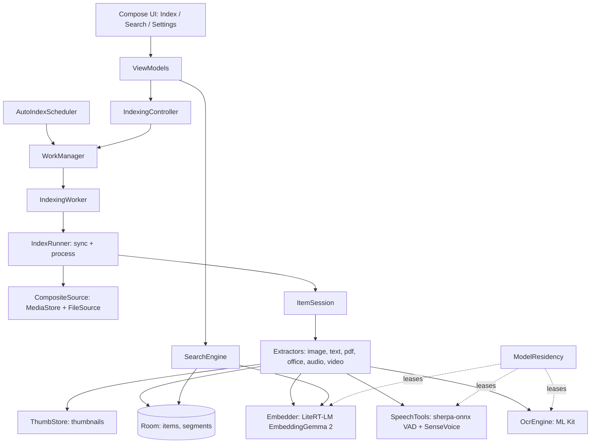

# Architecture

Package `com.lsa.app` (Kotlin, Jetpack Compose). Source root: `app/src/main/java/com/lsa/app`.

## 1. Goals and principles

- **On-device only.** Embedding, OCR and speech recognition run on the phone. The only network traffic is model download ([privacy](privacy.md)).
- **Models live outside the APK.** The user downloads them in Settings. Only ML Kit OCR and the 0.6 MB Silero VAD ship with the app.
- **One data model for every file type.** A file is an `item`; what is searched is a `segment`. New file types only add extractors and segment types.
- **Resumable.** Work is committed per file and checkpointed per segment batch, so a killed process resumes where it stopped.

## 2. System overview

## 3. Package map

| Package | Responsibility |
|---|---|
| `data/db` | Room entities, `ItemDao`, `Migrations.kt` |
| `data/media` | `MediaStoreRepository` (images, audio, video), `FileSource` (text and documents, needs All files access), `CompositeSource` |
| `data/prefs` | `SettingsStore` (DataStore): kinds, folders, model, auto-index mode, residency policy |
| `indexing` | `IndexRunner`, `ItemSession`, `IndexingController`, `IndexingWorker`, `AutoIndexScheduler`, `PipelineKeys`, `ImageExtractor` |
| `indexing/text` | `TextExtractor`, `TextChunker`, `MarkdownChunker`, `TextFormats`, `TextDecoder`, `TextRouting` |
| `indexing/docs` | `PdfExtractor`, `PdfText`, `OfficeExtractor`, `OfficeParsers`, `TextCard`, `ThumbStore`, `ZipSource` |
| `indexing/places` | `PlaceFinder`: offline GPS to place name (GeoNames cities, English and Korean) |
| `indexing/audio` | `AudioExtractor`, `AudioDecoder`, `Pcm` (window planning), `SpeechTools` |
| `indexing/video` | `VideoExtractor`, `VideoClips` |
| `ml`, `ml/embedding`, `ml/ocr` | `ModelResidency`, `Embedder` and `EmbeddingGemma2Embedder`, `OcrEngine` and `MlKitOcrEngine` |
| `models` | `ModelCatalog`, `ModelManager`, `ModelDownloader` (resumable), `ModelDownloadWorker`, `ArchiveExtractor` |
| `search` | `SearchEngine`, `Fusion`, `KeywordMatcher` |
| `ui` | `AppScaffold`, screens (`index`, `search`, `settings`, `onboarding`), `theme` |

## 4. Data model

Defined in `data/db/Entities.kt`.

**`items`** (one row per file): `sourceKey` (unique id of the source file), `kind` (`IMAGE, TEXT, DOC, AUDIO, VIDEO`), `uri`, `folderKey`
(same form as MediaStore `RELATIVE_PATH`), `displayName`, `mimeType`, `sizeBytes`, `modifiedAt`, `title`, `durationMs`, `pageCount`,
`width/height`, `dateTaken`, `latitude/longitude`, `place` (searchable place names, v3), `status` (`IN_PROGRESS, DONE, FAILED, SKIPPED`), `error`, `embeddingModelId`,
`pipelineKey`, `progress`, `indexedAt`.

**`segments`** (what is searched): `itemId`, `type`, `ordinal`, `startMs/endMs` (audio, video), `page`, `text`, `embedding`, `thumbPath`.

**`indexed_folders`**: `relativePath`, `enabled`, `recursive`.

| `SegmentType` | Produced by | Signal group |
|---|---|---|
| `IMAGE` | images | VISUAL |
| `OCR_TEXT` | images (ML Kit) | TEXT |
| `TEXT_CHUNK` | text files, document text | TEXT |
| `PAGE_IMAGE` | PDF pages | VISUAL |
| `CARD_IMAGE` | Office text cards | VISUAL |
| `TRANSCRIPT` | audio and video speech | TEXT |
| `AUDIO_CLIP` | audio windows (740M only) | AUDIO |
| `VIDEO_CLIP` | video clips | VISUAL |

**Vector format.** int8, stored as `[scale: float32][int8 × dim]` (`Quant`), 768 dims. Dot products are done in memory over all vectors.

**Migrations.** The schema is at **v3** (`AppDatabase.VERSION`; v3 added `items.place`). `Migrations.kt` holds `MIGRATION_1_2`, `MIGRATION_2_3` and the ordered `ALL_MIGRATIONS` list that `LsaApplication` registers. There is no destructive fallback on upgrade; only a downgrade (older build over a newer one) rebuilds the index, because it is derived data. Derived data that can be recomputed without a schema change is handled by `pipelineKey` instead. Policy: [development.md](development.md#schema-and-version-changes).

**App upgrades.** `AppUpgrade.run` (called from `LsaApplication`) compares the stored `last_version_code` with `BuildConfig.VERSION_CODE` and runs per-release steps for settings or file-layout changes. Auto Backup is disabled (`allowBackup="false"`): the index is derived and a restored database would not match missing thumbnails and models.

## 5. Indexing flow

Details in [indexing.md](indexing.md).

1. `IndexRunner.sync()` needs no model. It lists files from the sources, deletes rows whose file is gone, updates moved files, and computes the to-do set (new, changed, or `pipelineKey` differs). An empty listing never deletes anything (safety against revoked permission or unmounted storage).
2. `IndexRunner.process()` handles the to-do set one file at a time. `ItemSession` picks the extractor by kind; the extractor streams segments to a sink that commits them with the new `progress` value.
3. `pipelineKey` (`PipelineKeys.kt`) encodes everything that changes a kind's output: model id, chunker version, video precision, and so on. When it changes, only that kind is reprocessed.
4. Extractors throw `SkipItem` for unsupported, protected or too-large files; the item becomes `SKIPPED` with a reason.

## 6. Background execution

| Mode (`AutoIndexMode`) | Mechanism |
|---|---|
| MANUAL | User presses Start; work runs as foreground work with a notification |
| IMMEDIATE | WorkManager content-URI trigger on MediaStore (works while the app is dead), 15 s update delay, 2 min max delay |
| SCHEDULED | Periodic work at a chosen time, optional "charging only" |
| IDLE | Periodic work with charging + device idle constraints |

Automatic runs cannot start foreground services from the background on recent Android, so `setForeground` is attempted inside try/catch. `IndexingController` serialises runs (`runLock`), and a thermal gate pauses automatic runs when the device is hot. The mode is chosen on first launch.

## 7. Model lifetime

`ModelResidency` leases models through `LeasedResource`. Policy (`ResidencyPolicy`): `KEEP`, `IDLE_2M` (default, unload 2 minutes after the last lease), `IMMEDIATE`. `onTrimMemory` also releases models. It manages embedding, OCR and ASR. Log tag `LSA.Residency`.

## 8. Search (summary)

Segments are scored per signal group (VISUAL, TEXT, AUDIO) with a median-spread gate and relative scaling, combined with SQL `LIKE` keyword matches, grouped per item, and shown with the best location (page or time). See [search.md](search.md).

## 9. Design decisions

| Decision | Why | Alternative rejected |
|---|---|---|
| WorkManager content-URI trigger for IMMEDIATE | Works when the process is dead | `ContentObserver` (only while the app lives) |
| Relative score per signal group | Cosine ranges differ by space (unrelated OCR text still scores about 0.6) | Reciprocal rank fusion: ranks ignore how good the best hit is, so nonsense queries still return results |
| int8 vectors, full in-memory scan | Simple, fast enough to about 300k segments | ANN index (complexity, not needed yet) |
| SQL `LIKE` keywords | No extra index to maintain | FTS5 trigram (revisit if slow) |
| All files access for text and documents | MediaStore does not expose documents reliably | Storage Access Framework per folder |
| Office files become text + generated card image | Phones cannot render Office documents | Server-side rendering (not on-device) |
| Audio in two stages (transcript, then clips) | Speech recognition is cheap, audio embedding needs the 740M model; each stage checkpoints separately | One combined pass |
| Video as scene/length clips, up to 8 frames each | Several frames in one request give one vector (measured) | Per-frame vectors (storage) |

## 10. Limits and extension points

- About 300k segments is the target for the in-memory scan; beyond that add ANN or smaller (256-d) vectors.
- Keyword search is `LIKE`; move to FTS5 trigram if it slows down.
- New embedding or OCR models: see [models.md](models.md#adding-a-model).
- Known limits and plans: [roadmap.md](roadmap.md).
