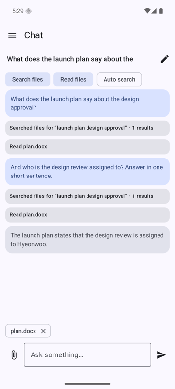

# Chat

An on-device assistant that answers questions from your files. Code: `chat/`, `ml/llm/`, `ui/chat/`.

## Sessions

Every conversation is a session (`chat_sessions`, `chat_messages`; schema v5 (v4 added the tables, v5 `pinned`)). Sessions are listed pinned first, then newest first (`chat_sessions.pinned`, schema v5); they can be renamed and deleted (the messages and picked photos go with them). The title is the first 40 characters of the first question until you rename it. Only one answer is generated at a time (one model in memory).

## What the model sees

For each question `ChatController.runTurn` builds the context:

1. **System prompt**: role, today's date, tool rules, "name the files and pages you used", "reply in the user's language", then the user's own instructions from Settings (`chatCustomPrompt`, up to 2,000 characters, labelled "the user's own instructions"). They go into the system prompt, not the question: the model follows them more reliably, they are not repeated in every turn and they do not appear in the transcript. Their size is deducted from the history budget and a hash of them is part of the conversation key, so editing them starts the model's state afresh.
2. **History**: the stored user and assistant messages before this question, newest first up to **60 %** of the context window minus the question and the system prompt (`ContextBudget`, tokens estimated as characters / 3). It always starts with a user turn. When turns are left out the chat says so. Tool calls of earlier turns are not replayed.
3. **The question**, preceded by attachments: for an attached indexed file the first 3,000 characters of its indexed text and its `item_id`; with **Auto search** on, the top 3 search results (800 characters each).
4. **Photos** picked with the attach button are passed as images to vision models (Gemma 4) and ignored by text-only models.

The context window (2K, 4K default, 8K) is set in Settings. LiteRT-LM keeps the model's own state between turns of a session; it starts over from the stored history when the tools change, an answer was cancelled, or the state reaches 70 % of the window.

## Rendering

Messages are shown as Markdown (`ui/common/Markdown.kt`): CommonMark with GFM tables, parsed by the commonmark library that indexing already uses, and drawn with Compose: headings, emphasis, inline code, code blocks, lists, quotes, links and simple tables. Your own messages use the same renderer.

## Tools

The model calls tools through LiteRT-LM's tool calling (`automaticToolCalling`). Each session can switch them on and off with the chips above the conversation; changing them starts a fresh model state from the stored history. At most 4 tool calls per question.

| Tool | Arguments | Result |
|---|---|---|
| `search_index` | `query` (required), `kinds` (`document,image,audio,video`), `date_from`, `date_to` (`YYYY-MM-DD`), `limit` (1 to 10, default 5) | JSON list of `item_id, name, kind, page or time, date, place, snippet`. Same engine as the Search screen: [search.md](search.md) |
| `read_file` | `item_id` (required), `page`, `from_sec`, `to_sec`, `offset`, `max_chars` (up to 4000, default 2000) | JSON with name, kind, date, place, pages or duration, `total_chars`, `next_offset` and the `text` slice |

`read_file` reads the **indexed text**, not the original file: document and text chunks (with `[p.N]` markers), transcripts of audio and video (with `[mm:ss]` markers, selectable by time) and OCR text of images. Files without indexed text say so.

Tool calls appear in the conversation as small cards ("Searched files for … · 3 results", "Read plan.docx"); tap a card to see the found files and open them.

**Auto search** is for models that handle tool calling poorly: before each question the app searches and puts the best excerpts in the context. It can be combined with the tools.

## Ask in chat

In Search, long-press a result to select files, then **Ask in chat** and pick a session or a new one. The files arrive as attachments in the message box; nothing is sent until you press send.

## Models and limits

Models are chosen and downloaded in Settings ([models.md](models.md#chat-models)); the first answer after loading a model takes longer (about a minute for Gemma 4 E2B on the emulator CPU). The chat model and the embedding model are in memory together while you chat (the search tool needs the embedder), and both follow the model memory policy.

- Small models can pick the wrong tool or arguments; Gemma 4 E2B called `search_index` and `read_file` correctly in the emulator test.
- Answers are only as good as the index: files that are not indexed, or indexed without text, cannot be read.
- Web search and fetching web pages are not available yet ([roadmap.md](roadmap.md)).
