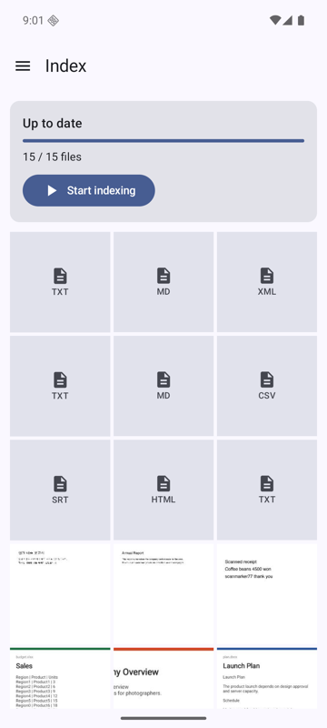
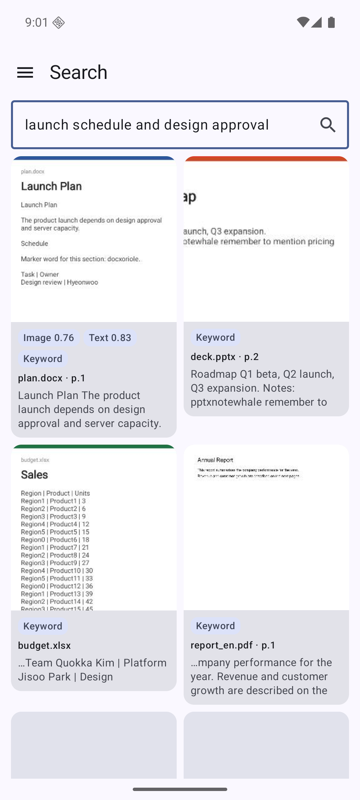
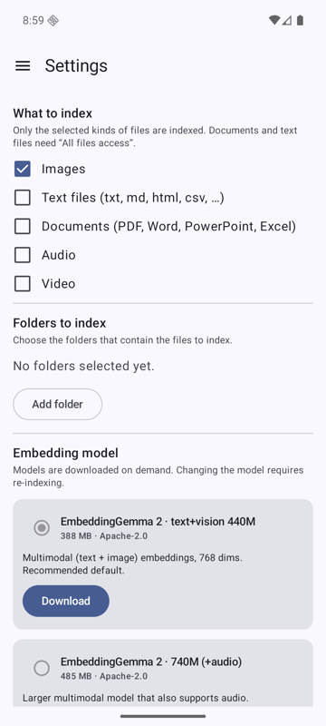
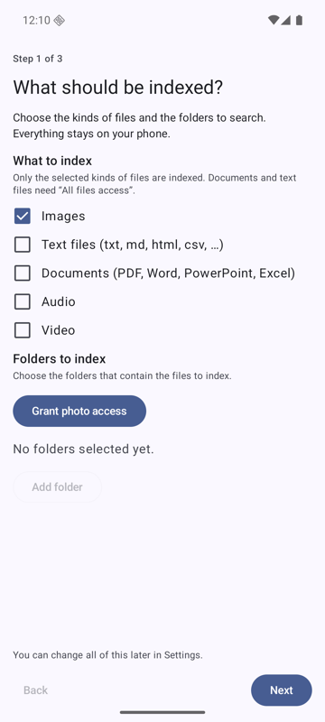
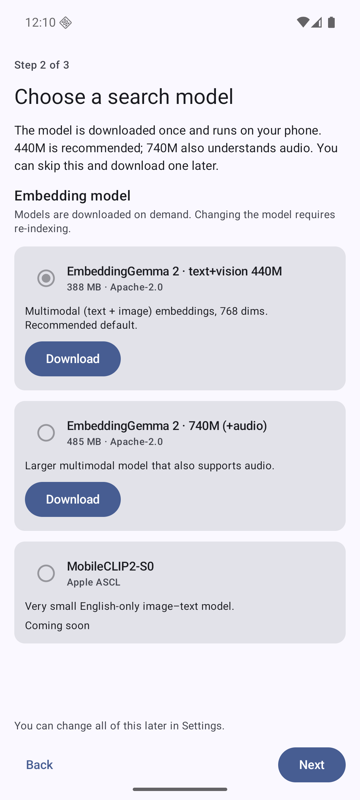
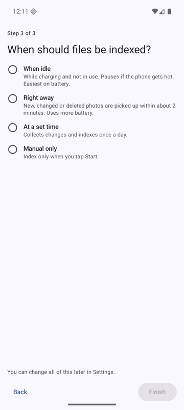
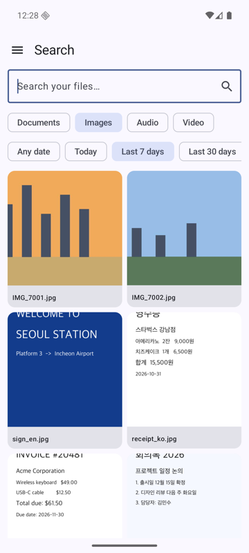
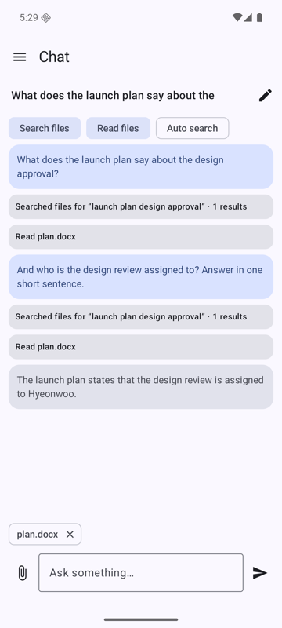
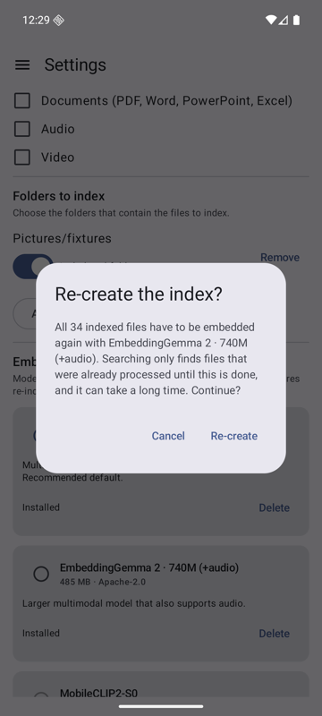

# User guide

  

## First run

A three-step wizard appears on the first launch. Everything in it can be changed later in Settings.

  

1. **What to index:** the kinds of files and the folders (the permissions they need are requested here).
2. **Model:** pick and download an embedding model (440M recommended, 740M also understands audio). You can skip it and download later; Search and Index tell you when no model is installed.
3. **Automatic indexing:** immediately, at a set time, when idle and charging, or manually.

## Index

Shows progress ("n / total files"), the file being processed, **Start / Pause**, and a thumbnail grid of indexed files. Indexing continues in the background with a notification, and resumes after the app is killed.

- **Failed files:** a "Failed (n)" chip filters the grid to files that could not be indexed (tap one to see the error); **Retry failed** runs only those files, without resuming the rest of a paused run. Failed files are also retried by every normal run.
- **Low-power mode:** for manual runs, a switch makes indexing slower but gentler: the CPU only (2 threads, no GPU), a short pause between files, and a stop when the phone gets hot.

## Search

Type a description ("launch schedule and design approval"), exact words, a place ("Dubai", "두바이", "중동") or a file name. Each result card shows a thumbnail, the file name with the best location (`p.3` for a page, `mm:ss` for audio/video), a snippet, and badges for what matched: Image, Text, Audio, Keyword. Tap a result to open it in another app; share one or several from the result actions. Exact keyword matches come first. Ranking details: [search.md](search.md).

**Filters:** the chips under the search box limit results to Documents, Images, Audio and/or Video, and to a date range (any date, today, last 7/30 days, this year, or pick dates; photos use the date taken). With a filter but no query you get a list of that kind of file, newest first. While a model switch is re-indexing, a banner says how many files are not searchable yet.

Photos with GPS data are found by place name. Results that match both the meaning and the place rank higher.

Tips: describe content in natural language for photos and scenes; use distinctive words for names, codes and numbers; Korean and English both work.

## Chat

Ask questions about your files. The model (Gemma 4 by default, downloaded in Settings) can search your index and read files by itself; each use appears as a small card you can open. Chats are kept in a list: pin (pinned chats stay on top), rename or delete them from the menu on each row; answers are shown with Markdown formatting (lists, code, tables, links); the context sent to the model is limited, so very long chats forget their oldest messages (a note says so).

- **Tools:** the chips above the conversation switch *Search files*, *Read files* and *Auto search* on or off for that chat.
- **Scheduled tasks:** ask in plain words, for example "every day at 9 summarize yesterday's photos", "every Monday 8:30 …", "in 30 minutes …" or "whenever a new document about the budget is added, summarize it". The assistant proposes a task card; press **Confirm** to start it. When it runs, the result is added to that chat and you get a notification; tapping it opens the chat. The clock button above the conversation lists the chat's tasks (pause, resume, delete). To change one, just ask ("move it to 6:30 pm", "make it weekly"); the change applies at once. Chats with tasks show a clock icon in the chat list. Tasks end when you delete the chat. **Tasks about new files run after indexing finishes, not the moment a file appears**, and they only post when a new file really matches your condition (the assistant checks each candidate first; a task needs a condition such as "receipt"; vague conditions like "anything with a schedule" work best with *Settings › Background tasks › Let the assistant judge new files*, which is on by default) (with manual indexing, when you start it). Use *Settings › Background tasks* (also an optional last step of the first-run wizard) to allow notifications, exact alarms and to exclude the app from battery optimization; on Samsung phones also remove it from *Sleeping apps* / *Deep sleeping apps*. Without these, tasks run late or not at all.
- **Attach:** the paperclip adds a photo (Gemma 4 can look at it). In Search, long-press results and choose **Ask in chat** to attach those files to a new or existing chat; they are sent with your next message.
- **Stop** ends an answer early. The first answer after starting the app is slower because the model has to load.
- Everything runs on your phone; chats are stored in the app's private storage and deleted with the chat.

See [chat.md](chat.md) for how the context is built.

## Settings

- **What to index:** Images, Text files, Documents, Audio, Video.
- **Folders:** quick-add chips for Camera, Screenshots and Downloads, or pick any folder; choose whether to include subfolders. (Without "All files access" only photos, audio and video in a folder are indexed.)
- **Speech recognition and OCR:** the first-run wizard offers the SenseVoice download when Audio or Video is on. OCR is Google ML Kit, built in, nothing to download. Android has no OCR API of its own, and its speech recognizer is meant for the microphone, so it is not used for files.
- **Chat instructions:** your own text added to the chat's system prompt for every conversation (up to 2,000 characters).
- **Resource indicator:** a top-bar readout of the backend (GPU/CPU) of the loaded models, app memory and CPU use. GPU load itself cannot be read by apps.
- **Embedding model:** download or delete 440M (text+image) or 740M (adds audio). Switching to another model asks for confirmation first, because every indexed file has to be embedded again; on "Re-create" the new model is applied and indexing starts. Until it finishes only the files already processed are searchable (Search shows a banner). Nothing is asked when nothing has been indexed yet.

- **Speech recognition:** needed for transcripts of audio and video.
- **Chat model:** download and select Gemma 4 E2B (default), E4B or Qwen2.5 1.5B, and choose the context size (2K, 4K, 8K).
- **Automatic indexing:** Manual; Immediately (new files are picked up in the background); Scheduled (a time, optionally only while charging); When idle (charging and idle).
- **Model memory:** keep loaded, unload after 2 minutes idle (default), or unload immediately. Lower memory use costs a reload on the next use.
- Dark mode follows the system.

## Why the permissions

See [privacy.md](privacy.md#permissions-androidmanifestxml).

## Troubleshooting

| Symptom | Check |
|---|---|
| Nothing found | Is the file `DONE` on the Index screen? Is the folder added and the kind enabled? Text/documents need All files access. |
| Documents or text never appear | Grant "All files access" in system settings. |
| Model download stalls | Retry; downloads resume. Hugging Face may need a token (Settings). |
| Slow indexing | Emulators use CPU. On phones, a hot device pauses automatic runs. |
| Audio never matches by sound | Audio embedding needs the 740M model; transcripts need the speech model. |
| Old .doc/.ppt/.xls or hwp | Unsupported; convert to the modern format or PDF. |
